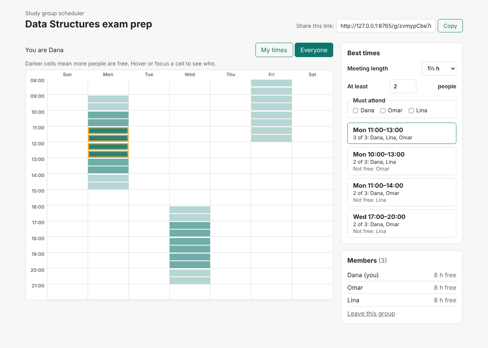

# fullstack-study-group-scheduler

[](https://github.com/AhmadElAmeer/fullstack-study-group-scheduler/actions/workflows/ci.yml)

A web app that finds when a study group can actually meet. Each member paints the half-hours they're free on a weekly grid. The app shows a heatmap of everyone's free time and lists the best meeting times, ranked by how many people can come. Back end: Flask and SQLite. Front end: plain JavaScript, no framework or build step.



## Problem

Finding a meeting time by group chat goes badly: "Monday works?" "Not for me" "What about after 4?" Polls like Doodle offer a few fixed options someone picked in advance. The real question is different: *given everyone's actual week, which times work for the most people, for long enough?*

That's a small but real algorithm problem. A naive answer is far too long. Every 30-minute shift of a free afternoon counts as another "valid" meeting time: in a 20-person test group, 674 intervals qualify for a one-hour meeting. This app reduces them to **maximal windows** (136 in that case), each a time range with the set of people who can come, ranked so the best is first.

## Overview

1. Someone creates a group and shares its link.
2. Members join with a name and paint their free times. Dragging works with mouse or touch, and the keyboard can do everything too.
3. Everyone sees a heatmap: darker means more people are free, and hovering a cell shows who.
4. The **Best times** panel takes a meeting length, a minimum number of people, and optional "must attend" members, then lists matching windows. Clicking one outlines it on the grid.

There are no accounts. Joining returns a random member key that the browser keeps. Only requests carrying that key can change or remove that member's times. The server stores only a SHA-256 hash of the key.

## Key features

- **Planner with a precise definition** (`scheduler/planner.py`). A window is a run of half-hours on one day, plus the members free for all of it. It's returned when:
  - it lasts at least the requested length;
  - it has at least *quorum* members, including every required member;
  - no other qualifying window covers the same time or more with the same members or more.

  Results are ranked by attendees, then length, then the earliest start.
- **The planner is checked against the definition itself:** a brute-force version that enumerates every interval, on 150 random weeks.
- **JSON API** with validation and clear error messages, JSON errors even for unknown routes, and status codes that mean something: 400, 403, 404 and 409.
- **SQLite schema doing real work:** foreign keys with `ON DELETE CASCADE`, `COLLATE NOCASE` uniqueness so "Dana" and "dana" can't both join, a `CHECK` on slot range, and a `WITHOUT ROWID` table keyed by (member, slot).
- **Safe handling of names:** user text always reaches the page through `textContent`, never as HTML. A browser test joins as `` and checks that nothing runs. SQL always uses parameters, and a test stores `Robert'); DROP TABLE members;--` literally.
- **Accessible grid:** every cell is a button with a spoken label ("Mon 11:00–11:30, free" or "…: 2 of 3 free (Dana, Omar)"). Arrow keys move between cells, Space toggles, and only one cell is in the Tab order. It works at phone width without horizontal page scrolling, and follows the system dark mode.

## Tech stack

- **Back end:** Python 3.11+, Flask 3, SQLite through the standard `sqlite3` module.
- **Front end:** HTML, CSS and JavaScript modules, with no framework and no build step.
- **Tests:** pytest, Flask's test client, and Playwright with Chromium for the end-to-end tests.
- **CI:** GitHub Actions runs the planner and API tests on Python 3.11, 3.12 and 3.13, and a separate job runs the browser tests and the benchmark.

## Architecture

```
browser                              Flask (scheduler/app.py)                    SQLite
───────                              ────────────────────────                    ──────
index.html + home.js   POST /api/groups ─────────► create group (random slug) ──► groups
group.html + group.js  GET  /api/groups/<slug> ──► members + slots, heat counts ◄─ members, availability
   paint grid          POST …/members ───────────► join, return member key once ─► members (key hash)
   save                PUT  …/members/<id>/availability  (X-Member-Key) ──────────► replace rows in one transaction
   "Best times"        GET  …/suggestions?duration&quorum&required ─► planner.find_windows
```

**The week** is 7 days × 28 half-hours (08:00–22:00), so every slot is one integer from 0 to 195 (`scheduler/grid.py`). Availability is stored as one row per free slot. Saving replaces a member's rows inside a single transaction, so nobody can read a half-saved week.

**The planner** gives each member one bit, so each slot becomes a bitmask of who is free. For every starting slot it extends to the right, AND-ing the masks. The set of free people only shrinks, so the scan stops as soon as fewer than *quorum* remain, or a required member drops out. While extending, it records the longest run for each distinct set of people. A final pass removes windows covered by another window on the same day. Windows never cross midnight, so only same-day windows need comparing. Every combination of "who is free" is considered without enumerating subsets of people, which would be exponential.

**Why maximal windows?** For two people free Monday 10:00–14:00 and 11:00–15:00, the planner returns three answers instead of dozens:
- both, 11:00–14:00;
- the first person alone, 10:00–14:00;
- the second person alone, 11:00–15:00.

Shorter slices of these add no information.

**The member key** is 24 random bytes (`secrets.token_urlsafe`), shown to the browser once and kept in `localStorage`. The server compares hashes with `hmac.compare_digest`. A request for a member through another group's link gets 404, so knowing one group's link reveals nothing about members of other groups.

## Installation

```bash
git clone https://github.com/AhmadElAmeer/fullstack-study-group-scheduler.git
cd fullstack-study-group-scheduler
python3 -m pip install flask
python3 -m scheduler            # http://127.0.0.1:8000, data in ./scheduler.db
```

Options: `--port 5000`, `--host 0.0.0.0`, and `--db path/to/file.db`.

For the tests, install pytest. Install Playwright too for the browser tests:

```bash
python3 -m pip install pytest playwright
python3 -m playwright install chromium
```

## Usage

In the browser: create a group, open the share link on each device, join, drag across the grid, then **Save my times**. Open **Everyone** to see the heatmap and **Best times**.

The API directly:

```bash
curl -s -X POST localhost:8000/api/groups -H 'Content-Type: application/json' -d '{"name": "Algorithms"}'
# {"slug": "Kef7wbx9U5...", "name": "Algorithms", "url": "/g/Kef7wbx9U5..."}

curl -s -X POST localhost:8000/api/groups/<slug>/members -H 'Content-Type: application/json' -d '{"name": "Dana"}'
# {"id": 1, "name": "Dana", "key": "..."}            (the key is shown only here)

curl -s -X PUT localhost:8000/api/groups/<slug>/members/1/availability \
     -H 'Content-Type: application/json' -H 'X-Member-Key: <key>' -d '{"slots": [32, 33, 34, 35]}'

curl -s 'localhost:8000/api/groups/<slug>/suggestions?duration=90&quorum=2&required=1'
```

`duration` is in minutes: a multiple of 30, from 30 to 480. It defaults to 60. `quorum` defaults to the whole group. `required` can be repeated. `limit` defaults to 10, with a maximum of 50.

## Results

`python3 scripts/bench.py`, second of the two runs in [docs/bench.txt](docs/bench.txt); the two agreed to within 0.3 ms. Python 3.13, SQLite 3.53, 2-core Intel Xeon @ 2.10 GHz.

Each group's members get a seeded random week shaped like a student's:
- weekday evenings free with 55% probability, from about 17:00 to 21:00;
- weekend daytime blocks with 35% probability;
- a few extra blocks and scattered half-hours.

The request time is the median of 50 requests through Flask (routing, SQLite query, planner, JSON).

| members | at least | length | request | planner alone | intervals that qualify | maximal windows returned | best window |
|---:|---:|---:|---:|---:|---:|---:|---|
| 5 | 3 | 1 h | 0.62 ms | 0.05 ms | 56 | 3 | Tue 17:00–21:30, 3 people |
| 5 | 1 | 1 h | 0.87 ms | 0.21 ms | 392 | 25 | Tue 17:00–21:30, 3 people |
| 20 | 10 | 1 h | 1.44 ms | 0.16 ms | 67 | 21 | Wed 18:00–20:00, 16 people |
| 20 | 10 | 2 h | 1.32 ms | 0.13 ms | 29 | 16 | Wed 18:00–20:00, 16 people |
| 20 | 1 | 1 h | 2.62 ms | 1.18 ms | 674 | 136 | Wed 18:00–20:00, 16 people |
| 60 | 30 | 1 h | 2.57 ms | 0.19 ms | 26 | 7 | Tue 18:30–20:00, 35 people |
| 60 | 1 | 1 h | 7.22 ms | 4.03 ms | 868 | 320 | Tue 18:30–20:00, 35 people |

What this shows:

1. **The maximal-window rule is what makes the list usable.** With 5 members and a quorum of 3, 56 intervals qualify but only 3 are distinct answers. The reduction is smaller in big groups with a quorum of 1 (868 → 320), because 60 people produce many genuinely different combinations. That's also why the API returns only the top 10 by default.
2. **It's fast at study-group sizes.** A full request takes 0.6–2.6 ms for realistic quorums. The worst case here, 60 members and a quorum of 1, is 7.2 ms, of which 4 ms is the planner. A realistic quorum makes the planner stop early, which is why the 60-member, quorum-30 run (0.19 ms) is about as fast as the 20-member one.
3. **With a quorum, most of the request isn't the planner.** It's 0.2 ms of planning out of 2.6 ms in the 60-member case. The rest is Flask, the SQLite query that loads every member's slots, and JSON encoding. I didn't measure how it splits between them, so profiling would come before any optimization.

## Testing

```bash
python3 -m pytest -q                  # 181 tests, about 6 seconds
python3 -m pytest -q -m "not browser" # without Playwright: 171 tests, under 1 second
```

- **Planner (156 tests):**
  - hand-checked cases for overlap, maximality and ranking;
  - duration, quorum and required members;
  - windows never crossing midnight, and the result limit;
  - invalid arguments;
  - **150 random weeks compared with the brute-force definition**, including ranking order and no duplicates. The random weeks were made denser after a check showed 91 of 150 produced no windows at all, which made the comparison weak. Now 121 of 150 have windows, 86 with several people.
- **API (15 tests):**
  - creating groups and name validation;
  - the group view, with grid, members and heat counts;
  - duplicate names (case-insensitive) and the 60-member limit;
  - keys stored hashed;
  - the member key required for changes, and members unreachable through another group's link;
  - slot validation, including that a rejected update leaves old data untouched;
  - leaving, with its cascade delete;
  - suggestions, with all their parameters and error cases;
  - JSON 404 and 405 responses.
- **Browser (10 tests, Chromium):**
  - two people in separate browser contexts find their common time;
  - dragging paints and drag-erases, and a single click toggles once;
  - keyboard editing with arrows, Space and Enter persists after a reload;
  - controls hide when they don't apply;
  - names containing HTML show as text, and no script runs;
  - a tampered key is reported instead of silently failing;
  - leaving the group, an unknown group's 404, and no horizontal scrolling at phone width.

**Planted bugs:** 20 bugs were planted one at a time:
- **planner:** windows crossing midnight, no maximality filter, required members ignored, duration off by one, wrong ranking, and windows recorded only at day end;
- **API:** key check skipped, member looked up without its group, old times not deleted, heat counted in the wrong slot, wrong default quorum, names not normalized, and slot bound off by one;
- **schema:** foreign keys off, and case-sensitive names;
- **front end:** names inserted as HTML, clicks toggled twice, drag toggling instead of painting, the key header not sent, and CSS overriding `hidden`.

All 20 are caught by the final suite. Three got through at first, and a test was added for each:
- old times not being deleted, because a test only read the PUT response;
- a double-toggling click;
- the CSS overriding `hidden`. That was also a real bug in the first version: the join form stayed visible after joining.

## Design decisions and challenges

- **Bitmasks for the planner.** Representing "who is free" as an integer turns set intersection into one `&` and counting into `bit_count()`. The scan is at most about 7 × 28 × 28 / 2 extensions however large the group is, and big groups mostly cost in the final de-duplication step.
- **Correctness by definition, not by example.** The maximality rule is easy to get subtly wrong (two of the planted bugs were exactly that). So the tests compare the fast planner with a slow version that applies the definition literally, on many random weeks.
- **No accounts, but not no security.** A shared link plus a per-member key fits a study group: nobody wants to register. Keys are hashed at rest, compared in constant time, and scoped to their group. What it doesn't protect against is anyone with the link adding fake members. That's acceptable for the use case, and noted below.
- **Painting needs care with pointer events.** The first `pointerdown` decides whether a drag paints "free" or "busy", so dragging back over cells is consistent. A mouse click is handled on `pointerdown`, and the `click` event only handles the keyboard (`event.detail === 0`); otherwise every click would toggle twice. A planted bug confirmed the tests catch that.
- **`[hidden]` versus CSS.** Setting `display: flex` on the join form overrode the `hidden` attribute, so the form stayed visible after joining. I spotted it in a screenshot, fixed it with `[hidden] { display: none !important; }`, and added a browser test so it can't come back unnoticed.
- **One row per free slot, not a bitmap column.** Rows let SQLite enforce the slot range and uniqueness, make cascade deletes work, and keep queries readable. At 196 slots per member at most, the size never matters.

## Future improvements

- Time zones, for groups spread across countries. Stored slots would need a zone, and daylight-saving changes make "every Monday at 18:00" ambiguous.
- Specific dates instead of a repeating week, for exam periods.
- Rate limiting on group creation and joining. The rate limiter from an earlier project of mine would fit here.
- Optional group admin key, to remove fake members.
- Live updates (server-sent events), so the heatmap changes as others save.

## What this project teaches

- Designing a JSON API: resources, validation, status codes, and consistent errors.
- Relational design in SQLite: keys, constraints, cascades, collations and transactions.
- Lightweight authorization without accounts, using hashed secrets and scoping.
- Writing interactive UI with plain DOM APIs: pointer events, keyboard support, ARIA labels, safe text rendering.
- An interval and set algorithm with bitmasks, and proving it against a brute-force definition.
- Testing a full stack at three levels, unit, API and real browser, and checking the tests by planting bugs.

## License

MIT — see [LICENSE](LICENSE).
